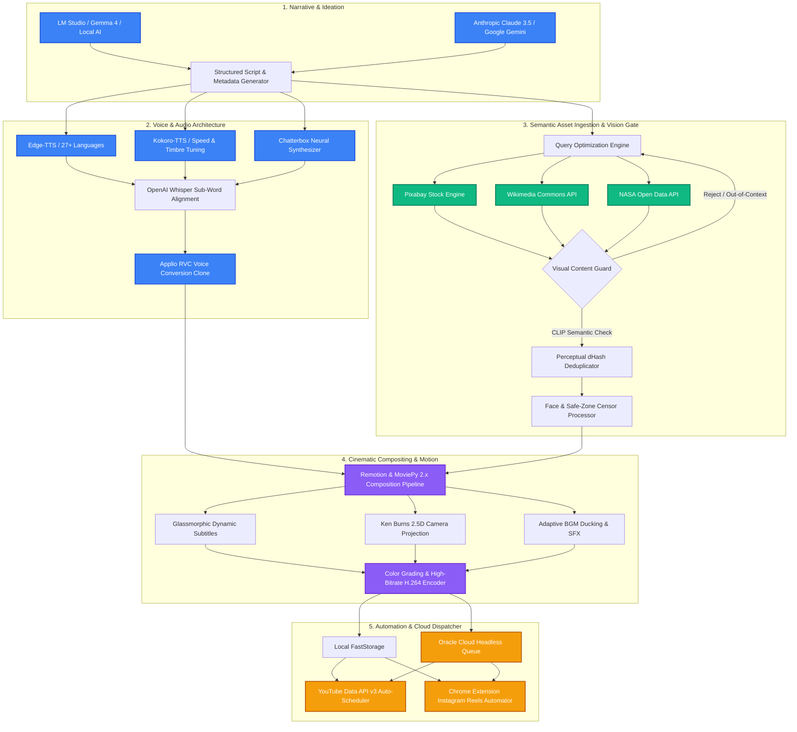

<div align="center">

# 🎬 Video Designer

### **Autonomous Multi-Modal Video Production Pipeline & Studio Control Center**

*An end-to-end programmatic video engineering system designed for high-throughput, cinematic short-form content creation across YouTube Shorts, Instagram Reels, and TikTok.*

---

[](https://python.org)
[](https://fastapi.tiangolo.com)
[](https://react.dev)
[](https://www.remotion.dev)
[](https://ffmpeg.org)
[](https://pytorch.org)
[](./LICENSE)

[Architecture](#-architectural-blueprint) •
[Core Modules](#-key-capabilities--system-modules) •
[Getting Started](#-getting-started) •
[Configuration](#-configuration--secrets-hygiene) •
[API Reference](#-rest-api-endpoints)

---

</div>

## 📌 Executive Overview

**Video Designer** bridges state-of-the-art Generative AI models (Local LLMs via LM Studio, Claude 3.5, Google Gemini) with production-grade programmatic rendering engines (Remotion, MoviePy, FFmpeg). 

Unlike standard video automation bots that generate generic slideshows, Video Designer implements:
* **Perceptual dHash & CLIP Vision Guard**: Guarantees zero repetition and enforces strict contextual relevance on media assets.
* **Studio Audio Pipeline**: Combines sub-word Whisper speech alignment, natural neural voices (Kokoro-TTS, Chatterbox, Edge-TTS), and local Applio RVC (Retrieval-based Voice Conversion) timbre transfer.
* **Glassmorphic Kinetic Typography**: Renders hardware-accelerated ASS subtitles with bouncy pop-ins, karaoke word highlights, and anti-orphan layout geometry.
* **Hybrid Local/Cloud Rendering**: Coordinates headless worker nodes on remote ARM/GPU cloud instances via secure SSH queues.

---

## 📐 Architectural Blueprint



---

## ✨ Key Capabilities & System Modules

### 🧠 1. Multi-LLM Scripting & Content Planning
* **Local-First Privacy**: Seamless native integration with [LM Studio](https://lmstudio.ai) running quantized local models (`Gemma 4`, `Llama 3`, `Mistral`) at zero API cost.
* **Cloud Fallback Orchestration**: Instant multi-provider switching to Anthropic Claude 3.5 Sonnet or Google Gemini 1.5 Pro with structured JSON output enforcement.
* **Autonomous Trend Assistant**: Conversational studio assistant that digests topic seeds, generates serialized episodic arcs, and constructs production plans.

### 🎙️ 2. Studio-Grade Voice Synthesis & RVC Timbre Transfer
* **Multi-Engine Audio Stack**: Supports Edge-TTS (27+ languages), Kokoro-TTS (8 international locales with parametric speed control), and Chatterbox.
* **Timestamp-Accurate Transcription**: Integrates OpenAI Whisper to extract word-level millisecond timestamps for frame-accurate visual cuts.
* **Post-Processing Voice Clone**: Native Applio RVC integration automatically re-renders vocal audio using custom `.pth` + `.index` neural vocal weights while preserving rhythm and pitch modulation.

### 🛡️ 3. Semantic Vision Guard & Deduplication
* **Perceptual dHash Index**: Enforces absolute zero duplicate visuals across a video timeline by computing perceptual 64-bit image hashes.
* **CLIP Semantic Gate**: Evaluates cosine similarity between audio narration sentences and media frames to weed out out-of-context stock photography.
* **Negative Prompt Sanitizer**: Excludes urban clutter, modern landmarks, and tourism banners during historical or documentary video sequences.
* **Smart Face & Privacy Censoring**: Automated detection and blurring/logo-patching of sensitive facial regions for anonymous storytelling formats.

### 🎬 4. Motion Design & Glassmorphic Typography
* **Kinetic Subtitle Engine**: Generates ASS and WebVTT subtitles styled with frosted glass backdrop blur, dynamic word karaoke highlights, and typographic anti-orphan algorithms.
* **Dynamic Camera FX**: Smooth 2.5D Ken Burns zoom, pan, and tilt transformations with cubic bezier easing.
* **Remotion Composition**: React-driven declarative video components for procedural overlays, countdown timers, and animated infographics.

### ☁️ 5. Distributed Cloud Worker Bridge
* **Headless Cloud Node Support**: Offload resource-intensive video renders to remote ARM64 / x86 cloud compute instances (e.g., Oracle Cloud).
* **Hardened SSH Protocol**: Implements modern `StrictHostKeyChecking=accept-new` verification and encrypted credential exchange.
* **Bi-directional Sync**: Transmits job payloads, tracks real-time remote stdout logs, and pulls completed H.264/H.265 deliverables back to local storage automatically.

### 📲 6. Autonomous Social Distribution
* **YouTube Data API v3**: Direct batch uploading with automated description formatting, tag generation, category mapping, and scheduling.
* **Zero-Ban Instagram Reels Integration**: Chrome Extension background bridge automates real-browser Instagram web uploads without triggering Meta API shadowbans.

---

## 🗂️ Repository Structure

```
video-designer/
├── src/
│   ├── server.py                   # FastAPI REST API & dashboard static server
│   ├── main.py                     # CLI orchestration engine & channel runner
│   ├── script_writer.py            # Multi-provider LLM prompt engineering
│   ├── video_generator.py          # Master timeline composer & audio-visual sync
│   ├── real_media_fetcher.py       # Pixabay, Wikimedia & NASA asset search
│   ├── visual_content_guard.py     # CLIP vision verification & negative filters
│   ├── glassmorphism_subtitles.py  # Frosted glass typography & ASS subtitle engine
│   ├── remote_runner.py            # SSH cloud rendering bridge & remote worker client
│   ├── voice_clone_manager.py      # Applio RVC inference & pitch manipulation
│   ├── settings_manager.py         # Fernet-encrypted credentials manager & .env loader
│   ├── channel_manager.py          # Channel metadata, scheduling & content rules
│   └── routers/                    # Modular FastAPI endpoint controllers
├── dashboard/                      # React 18 + Tailwind CSS Studio Control Center
│   ├── src/                        # UI components, state management & canvas views
│   └── dist/                       # Optimized production build artifacts
├── extension/                      # Chrome Extension for automated Instagram publishing
├── remotion/                       # Declarative React video rendering templates
├── config/                         # Channel definitions & encrypted configuration
├── .env.example                    # Clean environment variable specification
├── start.sh                        # Single-command environment initialization script
└── KURULUM.md                      # Detailed Turkish setup & configuration guide
```

---

## 🚀 Getting Started

### Prerequisites

* **Operating System**: macOS, Linux (Ubuntu 20.04+), or WSL2 on Windows.
* **Python**: 3.11 or higher.
* **Node.js**: 18.x or higher + npm.
* **FFmpeg**: Compiled with `libx264`, `libass`, and `libmp3lame` (`brew install ffmpeg` on macOS, `sudo apt install ffmpeg` on Ubuntu).
* **LM Studio** *(Optional for local AI)*: [Download LM Studio](https://lmstudio.ai).

### 1. Clone & Set Up Python Environment

```bash
# Clone the repository
git clone https://github.com/alieneseren/video-designer.git
cd video-designer

# Create and activate virtual environment
python3 -m venv .venv
source .venv/bin/activate

# Install dependencies
pip install -r requirements.txt
```

### 2. Configure Environment Variables

Copy the provided template and supply your local parameters:

```bash
cp .env.example .env
```

Edit `.env` with your preferred settings:

```dotenv
# Media API Keys
PIXABAY_API_KEY=your_pixabay_api_key_here
NASA_API_KEY=DEMO_KEY

# Cloud Worker Settings (Optional)
REMOTE_WORKER_HOST=192.168.1.100
REMOTE_WORKER_USER=ubuntu
REMOTE_WORKER_KEY_PATH=/Users/yourname/.ssh/id_ed25519
SSH_STRICT_HOST_KEY_CHECKING=accept-new
```

### 3. Build Dashboard & Launch

Execute the all-in-one startup script:

```bash
chmod +x start.sh
./start.sh
```

Once initialized, open your browser:
* **Control Dashboard**: `http://localhost:8000`
* **Interactive API Docs (Swagger)**: `http://localhost:8000/docs`

---

## ⚙️ Configuration & Secrets Hygiene

All sensitive configuration fields (API keys, SSH tokens, OAuth credentials) are strictly secured through a multi-tier hierarchy:

1. **Environment Variables (`.env`)**: Highest priority; never checked into version control.
2. **Fernet-Encrypted Local Vault (`config/settings.json`)**: Keys are encrypted at rest using an auto-generated machine secret key with file permissions `0600`.
3. **API Masking**: The REST endpoint `/api/settings` masks all secret strings (e.g., `5764••••••••••••••••••••••••••7c53`) before serving the UI.

| Variable | Description | Default |
|---|---|---|
| `PIXABAY_API_KEY` | Pixabay API Key for high-resolution stock video/photo retrieval | *None* |
| `ANTHROPIC_API_KEY` | Anthropic API Key for Claude 3.5 Sonnet ideation | *None* |
| `GEMINI_API_KEY` | Google AI Studio Key for Gemini 1.5 Pro | *None* |
| `NASA_API_KEY` | NASA Open API Key for space documentary media | `DEMO_KEY` |
| `REMOTE_WORKER_HOST` | Remote worker IP or hostname for distributed rendering | *None* |
| `REMOTE_WORKER_USER` | Remote worker SSH username | `ubuntu` |
| `REMOTE_WORKER_KEY_PATH`| Absolute path to SSH private key | `~/.ssh/id_rsa` |
| `SSH_STRICT_HOST_KEY_CHECKING` | SSH host verification mode (`accept-new` recommended) | `accept-new` |

---

## 📡 REST API Endpoints

The FastAPI backend exposes a comprehensive programmatic interface:

| Method | Endpoint | Description |
|---|---|---|
| `GET` | `/api/channels` | Retrieve all configured automated channels |
| `POST` | `/api/channels` | Register a new production channel profile |
| `POST` | `/api/run/{channel_id}` | Trigger an end-to-end video production pipeline |
| `GET` | `/api/run/status/{exec_id}` | Stream real-time generation logs & progress |
| `GET` | `/api/settings` | Retrieve active settings (with masked credentials) |
| `PUT` | `/api/settings` | Update system configuration and API credentials |
| `POST` | `/api/assistant/produce` | Process natural-language production instructions |
| `POST` | `/api/video-voiceover/jobs` | Enqueue a custom RVC voiceover synthesis job |
| `POST` | `/api/instagram/schedules/claim` | Chrome Extension bridge for scheduled reel uploads |
| `GET` | `/docs` | Interactive Swagger UI API documentation |

---

## 💻 CLI Orchestrator Usage

Video Designer can also run entirely headless through the command-line interface:

```bash
source .venv/bin/activate

# Execute all active channel production routines
python src/main.py

# Execute a specific channel
python src/main.py --channel ch_space_documentary

# Interactive setup wizard to register a new channel
python src/main.py --setup

# List all configured channels and their status
python src/main.py --list
```

---

## 🛡️ Responsible Disclosure & Security

This repository does not store any proprietary keys, user tokens, or identity secrets. If you identify an unintended vulnerability or security defect, please submit an issue or open a responsible disclosure dialogue via the author's GitHub profile.

---

## 📄 License

This project is open-source software licensed under the [MIT License](./LICENSE).

---

<div align="center">
<sub>Crafted with precision by <a href="https://github.com/alieneseren">Alien Esen</a></sub>
</div>
