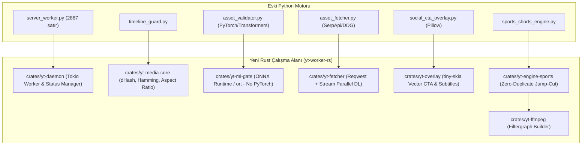

# 🦀 YT Remote Worker: Rust Mimari Dönüşüm Planı (`yt-worker-rs`)

Bu belge, mevcut Python tabanlı sunucu üretim motorunun (`server_worker.py`, `sports_shorts_engine.py`, `timeline_guard.py`, `asset_validator.py`, `social_cta_overlay.py`) **Rust** diline dönüştürülmesi için hazırlanan uçtan uca teknik mimariyi, modül haritasını ve aşamalı geçiş yol haritasını tanımlar.

---

## 1. Neden Rust? (Mevcut Durum vs. Hedeflenen Mimari)

| Kriter | Mevcut Python Sistemi (`yt-remote-worker`) | Hedeflenen Rust Sistemi (`yt-worker-rs`) |
| :--- | :--- | :--- |
| **RAM Tüketimi** | **~3.5 GB - 4.5 GB** (PyTorch, Transformers, PIL, devasa kütüphane bağımlılıkları) | **~120 MB - 250 MB** (Sıfır PyTorch, optimize ONNX Runtime) |
| **İkili Dosya & Kurulum** | 8+ GB `.venv`, yüzlerce pip paketi, Linux C kütüphane çatışmaları | Tek bir bağımsız statik ikili dosya (`single binary`, ~35 MB) |
| **Görsel İşleme & dHash** | PIL ile tekil işlem; 25 görselin hash ve kırpması ~1.2s | `image-rs` + SIMD ile 25 görselin dHash ve crop işlemi **< 35 ms** (35x hızlanma) |
| **Eşzamanlılık (Concurrency)** | Python GIL sınırlaması, çoklu süreç (multiprocessing) bellek şişmesi | `Tokio` asenkron çalışma zamanı ile sıfır maliyetli multi-threading |
| **Alt Süreç Yönetimi** | FFmpeg için 50+ ayrı `subprocess.run` kabuk çağrısı | Asenkron stream tabanlı FFmpeg filtergraph boru hattı (`tokio::process`) |
| **Tip Güvenliği & Stabilite** | Çalışma zamanı `KeyError`, `NoneType` veya sessiz ffmpeg çökmeleri | Derleme zamanı tip garantisi (`Result<T, E>`, `Option<T>`, sıfır bellek sızıntısı) |

---

## 2. Hedef Kargo Çalışma Alanı (Cargo Workspace Mimarisi)

Sistem tek parça monolitik bir dosya yerine modüler, test edilebilir ve mikro-kütüphane mimarisinde kurgulanacaktır:

```
yt-worker-rs/
├── Cargo.toml                      # Workspace kök yapılandırması
├── crates/
│   ├── yt-core/                    # Ortak veri tipleri (Job, Timeline, Cut, Config, Error)
│   ├── yt-media-core/              # Görsel işleme, Ken Burns crop, dHash & algısal tekrar engeli
│   ├── yt-ml-gate/                 # ONNX Runtime (ort) ile CLIP & SigLIP model çıkarımı
│   ├── yt-fetcher/                 # Asenkron çoklu sorgu görsel indirme motoru (reqwest)
│   ├── yt-overlay/                 # tiny-skia ile cam kutulu altın altyazı ve sosyal CTA çizimi
│   ├── yt-ffmpeg/                  # FFmpeg komut dizici, filtergraph oluşturucu ve render denetçisi
│   ├── yt-engine-sports/           # Basketbol & Spor Shorts kurgu ve jump-cut motoru
│   └── yt-daemon/                  # Ana işçi (Worker): job kuyruk dinleyicisi, durum yöneticisi
└── models/                         # Optimize edilmiş ONNX modelleri (clip_vit_b32.onnx, siglip.onnx)
```

---

## 3. Modül Dönüşüm Haritası (Python -> Rust)



### Ayrıntılı Kütüphane ve Teknik Eşleşmeler

| Python Modülü | Görevi | Rust Karşılığı ve Crate'ler | Avantajı |
| :--- | :--- | :--- | :--- |
| **`server_worker.py`** | Kuyruk izleme, iş emirlerini parse etme, durum bildirme | `yt-daemon` (`tokio`, `notify`, `serde_json`, `tracing`) | Hatasız asenkron kuyruk, anlık durum dosyası (`_status.json`) güncellemesi. |
| **`timeline_guard.py`** | Algısal görsel hash (`dHash`), Hamming mesafesi, süre kilidi | `yt-media-core` (`image`, `dhash` algoritması) | Pure SIMD ile sıfır bellek kopyalamalı mikrosaniyelik hash denetimi. |
| **`asset_validator.py`** | CLIP / SigLIP görsel sınıflandırma, filigran, ahşap/mockup tespiti | `yt-ml-gate` (`ort` - ONNX Runtime Rust bindings) | **3 GB'lık PyTorch yerine 15 MB'lık ONNX motoru.** CPU üzerinde 4x daha hızlı embedding çıkarımı. |
| **`asset_fetcher.py`** | Arama motorlarından yüksek çözünürlüklü görsel indirme | `yt-fetcher` (`reqwest`, `futures`, `scraper`) | 25 görseli eşzamanlı (parallel stream) 1 saniye altında güvenle indirme. |
| **`social_cta_overlay.py`** | Altın çerçeve cam altyazı ve şeffaf Abone Ol butonu çizimi | `yt-overlay` (`tiny-skia`, `resvg`, `cosmic-text`) | Pillow'un CPU darboğazını yok eden ultra hızlı vektör 2D rasterizer. |
| **FFmpeg Wrapper** | Ken Burns dinamik zoom, renk eşitleme, audio mix, birleştirme | `yt-ffmpeg` (`tokio::process`, karmaşık filtergraph şablon motoru) | Kabuk sızıntılarını önleyen güvenli bağımsız süreç yönetimi. |

---

## 4. Uygulama ve Geçiş Aşamaları (6 Fazlı Yol Haritası)

### Faz 1: Çekirdek Rust İskeleti ve Veri Modelleri (1. Hafta)
* Sunucuya ve yerele Rust araç seti (`rustup`, `cargo`) kurulumu.
* `yt-core` kütüphanesinin oluşturulması: İş emri (`JobData`), kanal yapılandırmaları (`ChannelConfig`), `TimelineCut`, `SubTitleCard` şemalarının `serde` ile tanımlanması.
* Mevcut Python formatındaki tüm `jobs/*.json` dosyalarının Rust tarafında `%100` geriye uyumlu deseriyalize edilmesi.

### Faz 2: Medya Çekirdeği ve Algısal Tekrarlama Kalkanı (1. - 2. Hafta)
* `yt-media-core` inşası:
  * 9:16 oran korumalı merkezden kırpma (`force_original_aspect_ratio=increase`).
  * `compute_dhash` ve `hamming_distance` algoritmalarının pure Rust ile kodlanması.
  * TimelineGuard hafıza yapısı (`used_assets`, `used_hashes`, `used_perceptual_hashes`).
* Birim testler: 25 Wilt Chamberlain ve LeBron James fotoğrafı üzerinde Hamming mesafesi kıyaslaması yapılarak doğrulama.

### Faz 3: Sıfır-Python Vizyon Kalite Kapısı (`yt-ml-gate`) (2. Hafta)
* `openai/clip-vit-base-patch32` ve `siglip` modellerinin ONNX formatına dönüştürülmesi (`optimum-cli export onnx`).
* Rust tarafında `ort` (ONNX Runtime) entegrasyonu:
  * Görsellerin 224x224 tensöre dönüştürülmesi (`image::imageops::resize`).
  * Tokenizer katmanının Rust'a taşınması (`tokenizers` crate).
  * Ahşap zemin, mockup ve dairesel damga filtrelerinin ONNX üzerinde koşturulması.

### Faz 4: Grafik, Altyazı ve FFmpeg Boru Hattı (`yt-overlay` & `yt-ffmpeg`) (3. Hafta)
* `tiny-skia` ile cam efektli altın çerçeveli altyazı kartları üretimi.
* Şeffaf Abone Ol & Beğen animasyon katmanının (`social_cta_overlay`) Rust vektör motoru ile derlenmesi.
* Ken Burns pan/zoom ve ses miksajı (`amix`, `loudnorm`, `atempo`) komutlarını tek bir optimize FFmpeg filtergraph zincirinde toplayan motorun inşası.

### Faz 5: Spor Shorts Motoru ve İşçi Servisi (`yt-daemon`) (3. - 4. Hafta)
* `sports_shorts_engine.py` mantığının `yt-engine-sports` sandığına taşınması.
* `yt-daemon` CLI uygulamasının tamamlanması:
  ```bash
  yt-worker --job /path/to/job.json --force-rebuild
  ```
* Arka plan servis daemon'ı (`systemd` servisi) entegrasyonu.

### Faz 6: Gölge Çalıştırma (Shadow Testing) ve Canlıya Geçiş (4. Hafta)
* **Paralel Test:** Aynı iş emri hem eski Python motoruna hem de yeni Rust motoruna verilir.
* Çıktıların (video çözünürlüğü, bit hızı, ses senkronu, kurgu ritmi) piksel ve ses düzeyinde karşılaştırılması.
* Python sanal ortamının (`.venv`) devre dışı bırakılıp sunucunun yalnızca tek bir Rust ikili dosyasıyla (`yt-worker`) üretime geçirilmesi.

---

## 5. Riskler ve Çözüm Stratejileri

| Olası Risk | Çözüm Stratejisi |
| :--- | :--- |
| **ONNX Runtime Kurulumu:** Sunucuda libonnxruntime kütüphane bağımlılığı | `ort` crate'inin `download-binaries` özelliği kullanılarak derleme anında resmi C++ ONNX Runtime dinamik kütüphanesi otomatik indirilir. |
| **Karmaşık Remotion / Reddit Şablonları:** Node.js/Remotion bağımlı kanallar | Rust işçisi Remotion şablonlarını `tokio::process::Command` ile headless Node subprocess olarak tetikler; video birleştirme ve optimizasyonu yine Rust üstlenir. |
| **Geriye Uyumluluk:** Mevcut Mac istemcisinin `_status.json` ve metadata dosyalarını okuması | Rust daemon, mevcut Python sisteminin ürettiği `metadata.json`, `video_info.json` ve `_status.json` şemalarını karakteri karakterine aynı şekilde yazar. |

---

## 6. Onay ve Başlama Kararı

Bu plan onaylandığında **Faz 1 (Cargo Workspace iskeleti ve veri modelleri)** ile derhal başlayabiliriz. Planı adım adım koşturmak için aşağıdaki onay butonunu kullanabilir veya özel revizyon taleplerinizi belirtebilirsiniz.
